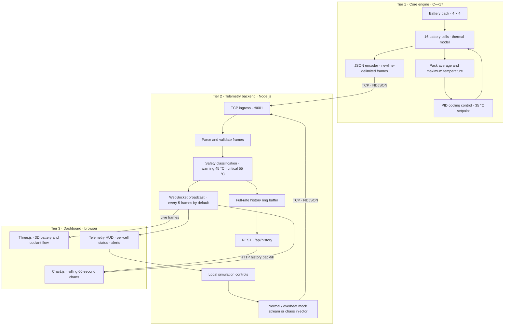

# ggthermalsync

A C++17 thermal physics engine and real-time telemetry pipeline that simulates an EV battery pack's thermal behavior and streams live JSON telemetry to an ingestion backend for dashboard visualization and automated fault handling.

## Architecture



## Tiers

### Tier 1 — Core engine (`core-engine/`)

A C++17 model simulates a 16-cell pack and uses PID control to regulate cooling. It emits newline-delimited JSON telemetry over TCP.

### Tier 2 — Telemetry backend (`telemetry-backend/`)

A Node.js service ingests and validates frames, applies thermal safety rules, stores recent history, and serves HTTP and WebSocket clients.

### Tier 3 — Dashboard (`dashboard/`)

A responsive Three.js and Chart.js interface shows the battery model, coolant flow, live charts, telemetry, and cell alerts in light and dark themes.

## Setup without Docker

Prerequisites: Node.js and Python 3. Install dependencies once with `cd telemetry-backend && npm ci`.

Open two terminals in the repository root and start the services:

**Terminal 1 — telemetry backend**

```bash
cd telemetry-backend
npm start
```

**Terminal 2 — dashboard**

```bash
python3 -m http.server 3000 --bind 127.0.0.1 --directory dashboard
```

Open [http://localhost:3000](http://localhost:3000). 

On the Simulation page, use **Start** and choose Normal or Overheat to launch a mock telemetry stream through the backend.

To use the C++ engine instead of the dashboard mock stream, build and run it from the repository root. Run only one telemetry producer at a time:

```bash
cmake -S core-engine -B core-engine/build -DCMAKE_BUILD_TYPE=Release
cmake --build core-engine/build --target BATTERYSIM --parallel
./core-engine/build/BATTERYSIM
```

For a command-line mock stream instead of the C++ engine or dashboard controls, stop any active producer first and run one of these from the repository root:

```bash
node scripts/mock-telemetry-stream.js
node scripts/mock-telemetry-stream.js --overheat
```

For the end-to-end fault scenario, keep the backend running and stop any other telemetry producer first:

```bash
node scripts/chaos-injector.js
```

## Setup with Docker Compose

Prerequisite: Docker Desktop or Colima running with Docker Compose available.

Create a local environment file and set a unique proxy token:

```bash
cp .env.example .env
openssl rand -hex 32
```

Paste the generated value into `SIMULATION_PROXY_TOKEN` in `.env`. 

From the repository root, build and start all services:

```bash
docker compose up --build
```

Open [http://localhost:3000](http://localhost:3000). Compose starts the dashboard, backend, and a finite core-engine simulation.

Use the dashboard controls to start a normal or overheat mock cycle, or a chaos injection after the initial engine run has completed.

Stop the stack with **Ctrl+C** when running in the foreground, or use `docker compose down` from another terminal. 

To run it in the background, use `docker compose up --build -d` and stop it with `docker compose down`.

## Telemetry frame

The engine sends one JSON object per line. A frame includes simulation time, pack temperatures, PID output, cooling level, and 16 cell temperatures. The backend adds safety status and trigger metadata before storing and broadcasting frames.

| Field | Meaning |
|---|---|
| `timestamp` | Simulation time in seconds |
| `temp_avg`, `cell_temps` | Pack average and 16 cell temperatures in °C |
| `pid_output`, `fan_speed` | PID output and cooling level (0–100%) |
| `fan_override` | Whether the critical-temperature safety override is active |
| `warning_threshold`, `critical_threshold` | Safety thresholds in °C (45 / 55 by default) |
| `safety_status`, `backend_safety_trigger` | Backend safety classification and action metadata |

## Monorepo structure

```text
ggthermalsync/
├── core-engine/                  # C++17 simulation and TCP telemetry client
│   ├── include/                  # Engine, PID, safety, and telemetry headers
│   ├── src/                      # Simulation implementation
│   └── Dockerfile
├── telemetry-backend/            # Node.js TCP, HTTP, WebSocket, and history service
│   ├── src/                      # Server, TCP ingest, and ring buffer
│   ├── test/                     # Backend tests
│   └── Dockerfile
├── dashboard/                    # Static web dashboard
│   ├── css/                       # Responsive light/dark styling
│   ├── js/                        # Three.js, charts, telemetry, and controls
│   ├── nginx.conf.template        # Static server and API/WebSocket proxy
│   └── Dockerfile
├── scripts/                      # Mock telemetry and chaos injector
├── teles/                        # 3D model and visual reference assets
├── .env.example                  # Local Compose configuration template
├── docker-compose.yml            # Local multi-service orchestration
└── README.md
```

## Status

| Area | State | Includes |
|---|---|---|
| Core engine | Implemented | 16-cell thermal model, PID cooling control, safety override, TCP telemetry |
| Telemetry backend | Implemented | TCP validation, ring-buffer history, HTTP API, WebSocket stream, safety triggers, simulation controls |
| Dashboard | Implemented | Responsive views, 3D battery/coolant model, rolling charts, cell HUD, alerts, light/dark theme |
| Fault injection | Implemented | Normal and overheat mock streams; Cell #3 chaos scenario with backend and PID verification |
| Docker Compose | Implemented | Engine, backend, and static dashboard services with local networking |
